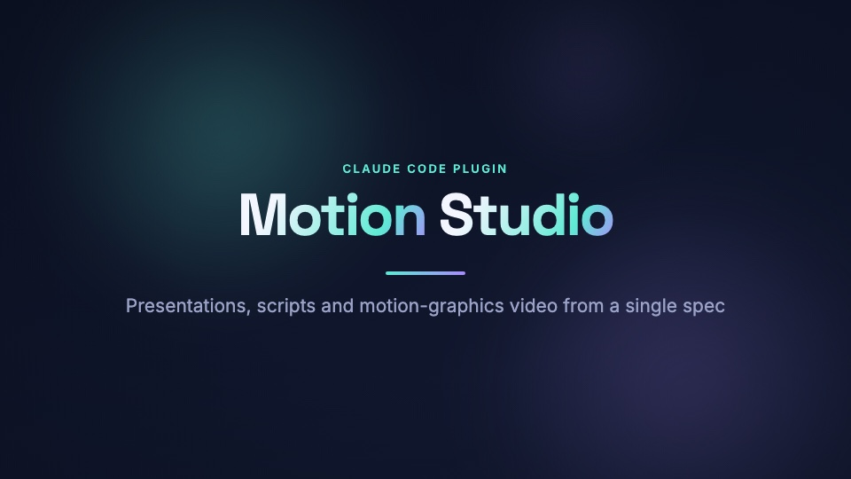
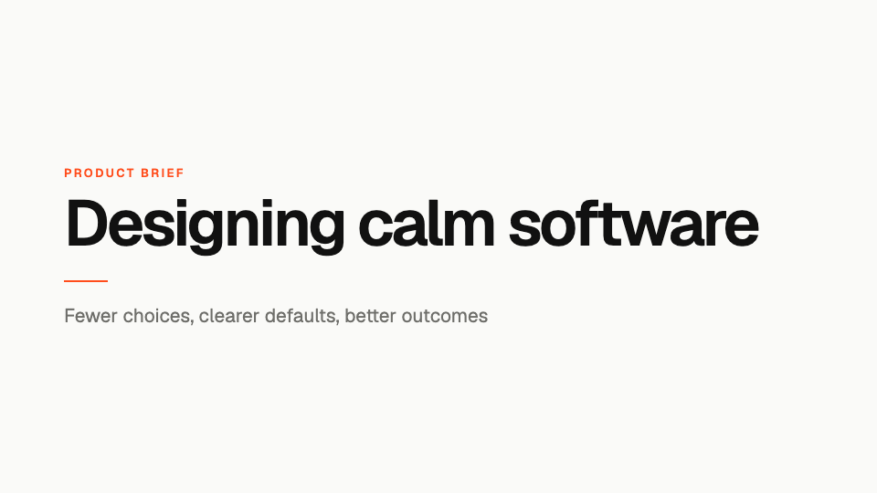
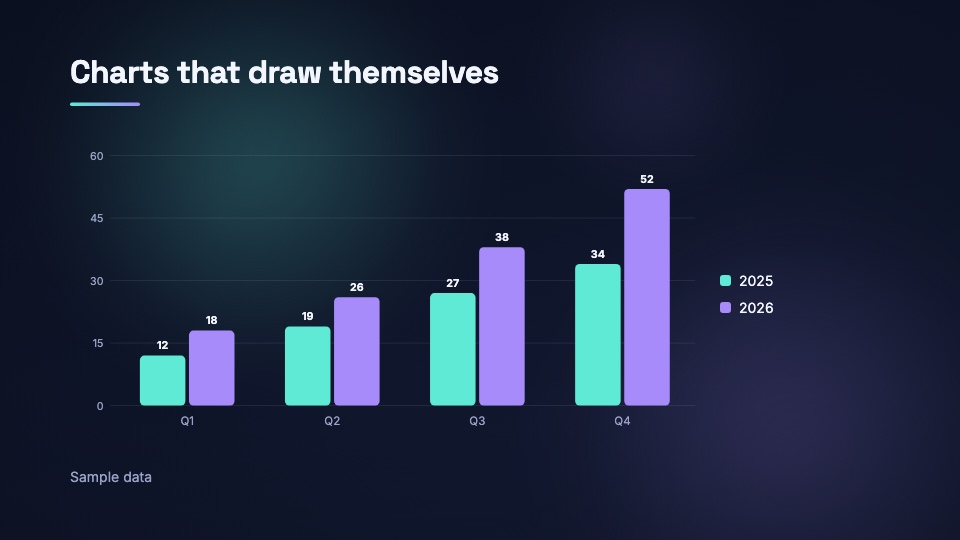
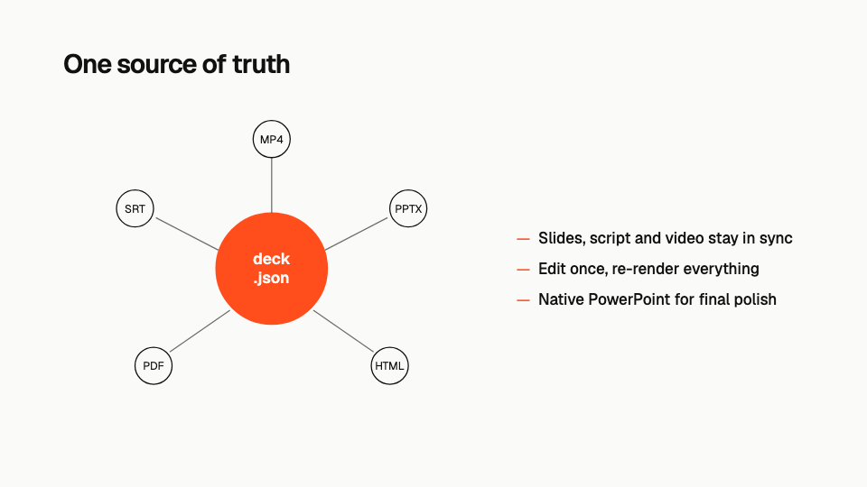
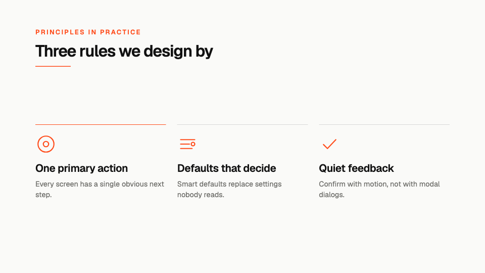
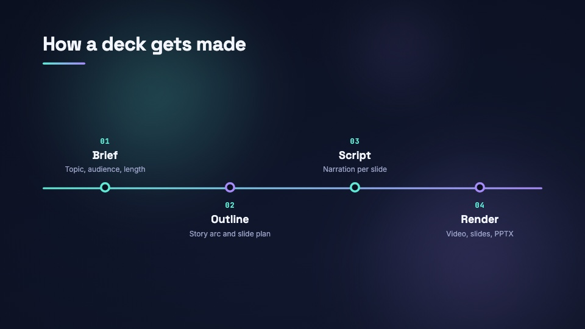
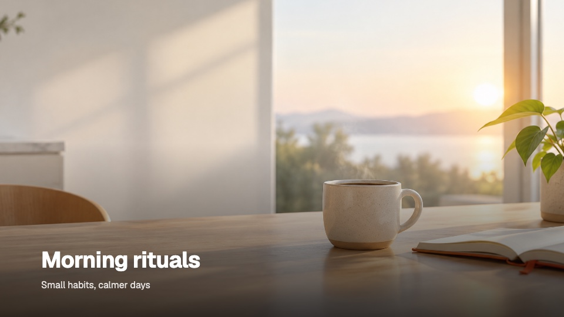
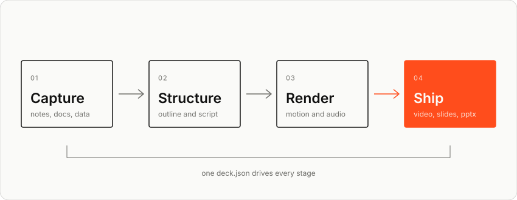
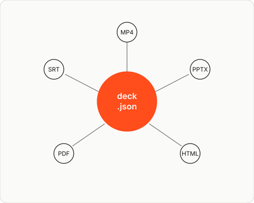
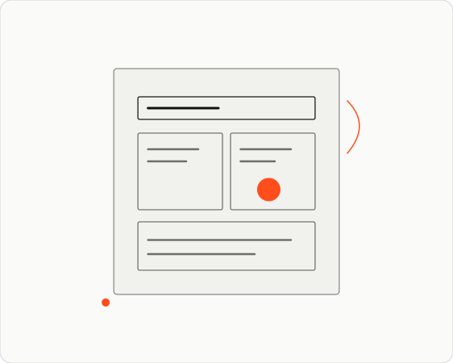

# motion-studio

**English** | [한국어](README.ko.md)

A Claude Code plugin that turns a topic, brief or document into:

- **Motion-graphics video** (MP4, 1080p, rendered with [Remotion](https://remotion.dev))
- **HTML slides**: a single self-contained file that plays each slide's animation live. With `--html-audio` the narration is embedded; the deck opens silent with a Play button, and M toggles mute
- **Editable PowerPoint** (.pptx) with native text, charts and speaker notes
- **PDF** handout
- **Script** (Markdown with timestamps) and **subtitles** (SRT, and burned into the video when there's no voice-over)
- Per-slide **annotations** for sources and footnotes: shown small on the slide, linked in HTML/PPTX, listed in the script
- Optional **narration** via local open-source TTS: [Supertonic](https://github.com/supertone-inc/supertonic) (or macOS `say` for quick drafts), with mixed-language pronunciation handling (e.g. Korean narration with English terms)
- Optional **generated images** through a pluggable image-provider interface, starting with OpenAI `gpt-image-2.5` (flare/sunburst)

All of it comes from a single `deck.json`, so slides, script and video never drift apart.

## Showcase

Stills from the decks in [`examples/`](examples/), as rendered by `motionstudio stills`. In the video and HTML deck every element animates in.

<table>
  <tr>
    <td width="50%"><br><sub><b>Expressive</b> style, <code>midnight</code> theme: gradient headline, glow, animated background (<code>showcase</code>)</sub></td>
    <td width="50%"><br><sub><b>Minimal</b> style, <code>minimal</code> theme: editorial alignment, one accent, calm motion (<code>minimal</code>)</sub></td>
  </tr>
  <tr>
    <td><br><sub><code>chart</code>: bars grow in and values count up; exported as a native, editable PowerPoint chart</sub></td>
    <td><br><sub><code>visual</code>: an SVG diagram drawn by Claude, traced on step by step, with notes beside it</sub></td>
  </tr>
  <tr>
    <td><br><sub><code>cards</code> with SVG icons that follow the theme color</sub></td>
    <td><br><sub><code>timeline</code>: the line draws across, milestones pop in one by one</sub></td>
  </tr>
  <tr>
    <td><br><sub><code>image</code> with a picture generated by <code>gpt-image-2.5</code> and a slow Ken Burns zoom (<code>generated-images</code>)</sub></td>
    <td><br><sub>Korean deck on the <code>paper</code> theme, narrated with Supertonic (<code>korean</code>)</sub></td>
  </tr>
</table>

### SVG visuals

Claude draws diagrams, illustrations and icons as SVG with theme color tokens (`var(--accent)`, `var(--text)`…), so one file works on every theme. These are the SVGs from [`examples/minimal/assets/`](examples/minimal/assets/), shown here with the `minimal` and `minimal-dark` colors (they follow your GitHub light/dark setting):

<picture>
  <source media="(prefers-color-scheme: dark)" srcset="docs/images/diagrams/flow-dark.svg">
  
</picture>

<p>
<picture>
  <source media="(prefers-color-scheme: dark)" srcset="docs/images/diagrams/hub-dark.svg">
  
</picture>
<picture>
  <source media="(prefers-color-scheme: dark)" srcset="docs/images/diagrams/layers-dark.svg">
  
</picture>
</p>

In a deck, groups marked `data-step` trace on in narration order: strokes draw first, then fills and text fade in.

## Install

From GitHub (the repository is private, so your `git`/`gh` login needs access):

```bash
claude plugin marketplace add hjs-gith/motion-studio
claude plugin install motion-studio@motion-studio-marketplace
```

Or from a local clone: `claude plugin marketplace add /path/to/motion-studio`, then the same `install` command. To pick up a new version later, run `claude plugin update motion-studio@motion-studio-marketplace` and restart Claude Code.

Then, in any Claude Code session:

```
/motion-studio:setup                  # installs the render engine (first time, ~1–2 min)
/motion-studio:setup supertonic       # optional: narration
/motion-studio:create a 3-minute explainer on how vaccines train the immune system, with narration
```

Or just ask: *"make a pitch deck and video for my app from ./notes.md"*. The `create` skill triggers on its own.

## Skills

| Skill | What it does |
|---|---|
| `/motion-studio:create` | Brief → research → outline → deck.json → validate → visual review of stills → TTS → render |
| `/motion-studio:render` | Re-render an existing deck (all formats or a subset, draft or final) |
| `/motion-studio:setup` | Install/check the engine and Supertonic TTS |

## CLI

The plugin puts `motionstudio` on Claude's PATH (`plugins/motion-studio/bin/`). You can run it yourself too:

```bash
motionstudio init my-talk --title "My Talk" --theme minimal
motionstudio validate my-talk          # schema check, lint, per-slide timing
motionstudio stills my-talk            # PNG of every slide → my-talk/out/stills/
motionstudio tts my-talk --preview     # show exactly what will be spoken (lexicon, acronyms, ⟦en: …⟧ segments)
motionstudio tts my-talk               # narration → my-talk/assets/audio/
motionstudio images my-talk            # plan generated images (nothing billed)
motionstudio images my-talk --yes      # generate them (paid; needs OPENAI_API_KEY)
motionstudio render my-talk            # video, html, pptx, pdf, script
motionstudio render my-talk --formats video --draft
motionstudio render my-talk --no-voice # no voice-over: silent video with burned-in subtitles
motionstudio themes | schema | doctor
```

## Deck project layout

```
my-talk/
  deck.json          # the source of truth
  assets/            # images, music; audio/ holds generated narration
  out/               # my-talk.mp4 .html .pptx .pdf -script.md .srt, stills/
```

**18 layouts:** `title`, `section`, `agenda`, `bullets`, `cards`, `statement`, `quote`, `big-number`, `stat`, `chart` (bar/line/donut), `visual` (animated SVG), `image`, `image-text`, `split`, `comparison`, `timeline`, `code`, `end`.

**Two styles, eight themes.** `minimal` style (flat accents, hairlines, editorial alignment, calm motion) is used by `minimal`, `minimal-dark`, `swiss` and `corporate`. `expressive` style (gradients, glow, springy motion) is used by `midnight`, `aurora`, `noir` and `paper`. Any preset can switch style with `theme.style`, and colors and fonts can be overridden, so you can restyle a deck just by asking Claude.

**SVG visuals.** Claude draws diagrams, illustrations and icons as SVG using theme color tokens. They trace themselves on in the video and HTML deck (ordered with `data-step`), recolor with the theme, and are rasterized to crisp PNGs for PPTX/PDF (see [Showcase](#svg-visuals)).

Transitions: `fade`, `slide`, `wipe`, `flip`, `clock-wipe`, `iris`.

See [`skills/create/reference/deck-spec.md`](plugins/motion-studio/skills/create/reference/deck-spec.md) for the full format and [`svg-visuals.md`](plugins/motion-studio/skills/create/reference/svg-visuals.md) for SVG authoring. [`examples/`](examples/) has sample decks: `minimal` (all new layouts and SVG diagrams), `showcase` (expressive, narrated), `korean` (mixed-language narration) and `generated-images` (image generation; placeholders until a key is set).

## Generated images

Add `"generate": { "prompt": "…" }` to an `image`, `image-text` or `split`-column slide. Until the image exists the slide shows a theme-colored placeholder, so layouts can be reviewed for free. `motionstudio images` prints a plan, and `--yes` generates. Results are cached by prompt, style, model, quality and size, so nothing is billed twice. To enable OpenAI, set your key yourself:

```bash
echo 'export OPENAI_API_KEY=sk-...' >> ~/.zshrc
```

(or add `"env": { "OPENAI_API_KEY": "…" }` to `~/.claude/settings.json`). Providers live in `engine/src/images/`; adding Gemini, Recraft or FLUX means implementing one `ImageProvider`. See [`images.md`](plugins/motion-studio/skills/create/reference/images.md).

## Annotations and decks without voice-over

Each slide can carry `annotations`: short source or footnote lines (`"Source: OECD, Education at a Glance (2024)"` or `{ "text": "…", "url": "…" }`) shown in the slide's bottom margin, with live links in HTML and PPTX.

Narration is optional as audio. With `voice.engine: "none"` (the default) the narration text still drives slide timing and becomes burned-in subtitles plus an SRT for the video, presenter notes in the HTML deck (press N) and PPTX, and the script. `motionstudio render <dir> --no-voice` makes the same silent version of a narrated deck. See [`deck-spec.md`](plugins/motion-studio/skills/create/reference/deck-spec.md).

## Mixed-language narration

Korean narration is also **evenly paced**: sentences are voiced one by one and re-voiced toward a calibrated rate, so short sentences no longer rush and long ones no longer drag (`voice.pace`, on by default).

Supertonic voices one language per call. Before synthesis, `voice.lexicon` respellings (`"Prompt": "프롬프트"`), acronym spelling (AI → 에이아이) and English-phrase segmentation are applied to the **audio only**; slides and captions keep the original text. See [`voices.md`](plugins/motion-studio/skills/create/reference/voices.md).

## How it works

```
plugins/motion-studio/
  .claude-plugin/plugin.json
  bin/motionstudio            # launcher: installs engine to ~/.cache/motion-studio, forwards commands
  skills/                     # create / render / setup (+ reference docs)
  engine/
    src/spec.ts               # zod schema for deck.json
    src/timeline.ts           # timing: narration-driven slide durations, transitions, captions
    src/video/                # Remotion compositions, layouts, motion primitives, backgrounds
    src/video/look.ts         # style tokens (minimal vs expressive) used by every layout
    src/video/SvgVisual.tsx   # frame-driven SVG draw-on animation
    src/svg-utils.ts          # SVG sanitizing, theme-token substitution, aspect/keys
    src/images/               # image-provider interface, OpenAI provider, placeholders, job planning/cache
    src/pronounce.ts          # TTS pronunciation: lexicon, acronyms, language segments
    src/export/               # pptx (pptxgenjs), pdf (pdf-lib), html (esbuild + @remotion/player), script/srt
    src/cli/                  # CLI, Remotion bundling/rendering, TTS orchestration
    tts/synth.py              # Supertonic batch worker
```

- Slide duration = the longer of the layout minimum and (narration audio + lead-in + tail + transition). Without audio it uses estimated speaking time, so silent videos are still paced to the script.
- TTS output is cached per slide by a hash of text and voice settings; only changed slides are re-synthesized.
- The engine runs from its own directory, so Remotion's headless Chrome is cached there and never inside your project.

## Development

When the plugin is installed from this local marketplace, Claude Code reads it in place. If `plugins/motion-studio/engine/node_modules` exists, the launcher uses the engine in place too (dev mode); otherwise it copies it to `~/.cache/motion-studio/engine`.

```bash
cd plugins/motion-studio/engine && npm install && npx tsc --noEmit
claude plugin validate .
```

Run `/reload-plugins` in a session after editing skills.

The README images live in `docs/images/`. `slides/` holds stills of the example decks (`motionstudio stills examples/<name> --scale 0.5`). `diagrams/` holds copies of `examples/minimal/assets/*.svg` with the theme tokens replaced by the `minimal` and `minimal-dark` colors, because GitHub shows SVGs as plain images with no theme variables. Refresh them when the examples change.

## Licensing notes

Remotion is free for individuals and companies with up to 3 employees; larger companies need a [company license](https://remotion.dev/license). Check the Supertonic model license on Hugging Face before commercial use.
